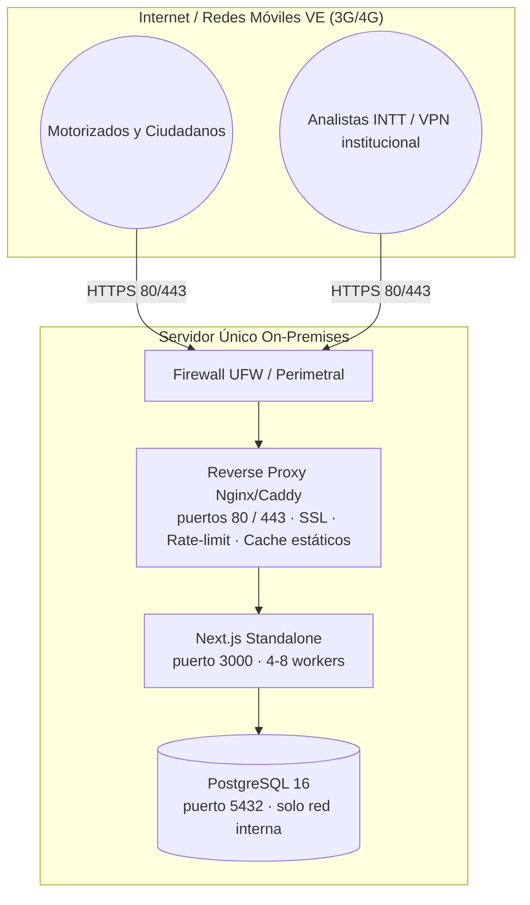

# Recomendación de Despliegue, Hardware y Conectividad
**Proyecto:** Encuesta Visión Cero — Instituto Nacional de Transporte Terrestre (INTT)  
**Escenario:** Recolección masiva dirigida a los motorizados y ciudadanos de Venezuela  
**Modalidad:** Servidor privado (On-Premises / Datacenter INTT)  
**Versión:** 1.0.0  
**Fecha:** Octubre 2026  
**Estado:** Recomendación técnica oficial

---

## 1. Resumen Ejecutivo

Se recomienda desplegar la plataforma completa en **una única máquina virtual robusta**, ejecutando todo el stack con **Docker Compose** (aplicación Next.js + PostgreSQL + reverse proxy). Esta decisión reemplaza la arquitectura de 5 máquinas virtuales del SAD (documento `ARQUITECTURA_REQUERIDA.md`) como **configuración por defecto**, por las siguientes razones:

1. **La carga real no exige separación física:** 1M de encuestas en 15 días ≈ 0,8 TPS promedio y 30–50 TPS pico. Un único servidor de gama media- alta lo absorbe sin saturar CPU ni disco.
2. **Simplificación operativa:** un solo `docker compose up -d` levanta y actualiza todo el sistema, con respaldos y monitoreo centralizados.
3. **Menor superficie de fallo y de mantenimiento:** una sola VM, un solo SO que parchear, un solo punto de respaldo.
4. **El cuello de botella real no es el cómputo:** es la conectividad del enlace y el dimensionamiento de la conexión a la base de datos, que se resuelven con configuración (no con más hardware).

> La arquitectura de 5 VMs del SAD queda como **plan de escalamiento futuro** (Sección 7) solo si la campaña supera las métricas de carga previstas o si el INTT exige aislamiento físico por política institucional.

---

## 2. Metas de Carga Referencia

Tomadas de `docs/ARQUITECTURA_REQUERIDA.md` (SAD v1.1):

| Métrica | Valor |
| :--- | :--- |
| Encuestas objetivo | 1.000.000 en 15 días continuos |
| Visitantes únicos estimados | 2.000.000 – 3.000.000 |
| Throughput promedio diurno | ~1,1 – 1,5 envíos/segundo |
| **Pico de envíos (POST submit)** | **30 – 50 TPS** |
| **Solicitudes HTTP pico (servidor web)** | **350 – 600 RPS** |
| Concentración temporal | 70% entre 08:00 y 20:00 |
| SLA comprometido | 99,9% durante la campaña |

---

## 3. Características del Hardware Recomendado

### 3.1. Máquina Única (Configuración Recomendada)

| Recurso | Mínimo Aceptable | **Recomendado** | Detalle |
| :--- | :--- | :--- | :--- |
| **vCPU** | 8 | **16** | Multiproceso de Next.js (4–8 workers) + PostgreSQL + Nginx |
| **Memoria RAM** | 16 GB | **32 GB** | PG cache (24 GB) + app + SO |
| **Almacenamiento** | 120 GB | **240 GB SSD** | Datos (~2 GB) + índices (~1 GB) + WAL + respaldos locales (30 días) |
| **Tipo de disco** | SSD | **SSD NVMe** | `random_page_cost = 1.1`; escrituras de submit en milisegundos |
| **Red** | 1 Gbps | **1 Gbps dedicado** | NIC única con VLAN de gestión opcional |
| **Sistema Operativo** | — | **Ubuntu Server 22.04/24.04 LTS o Debian 12** | Arquitectura `amd64`; el stack es Docker |

> **Nota de dimensionamiento de disco:** con 1M de registros el volumen de datos es pequeño (~2 GB datos + índices, ~20 GB con WAL y temporales). El espacio en disco no es un factor de riesgo; la RAM destinada al caché de PostgreSQL **sí lo es**.

### 3.2. Ajustes de PostgreSQL Recomendados (ya en `docker-compose.yml`)

| Parámetro | Valor | Base de cálculo |
| :--- | :--- | :--- |
| `shared_buffers` | 512 MB → subir a **4 GB** | ~25% de la RAM del servidor |
| `effective_cache_size` | 1536 MB → subir a **12 GB** | ~75% de la RAM |
| `work_mem` | 16 MB | Ordenaciones y hashes |
| `random_page_cost` | 1.1 | Disco SSD/NVMe |
| `max_connections` | 200 | Pool de conexiones de Prisma + Nginx |

---

## 4. Conectividad y Red

### 4.1. Topología Recomendada (Máquina Única)



### 4.2. Puertos y Exposiciones

| Servicio | Puerto | Exposición | Regla |
| :--- | :--- | :--- | :--- |
| **HTTPS (público)** | 80 / 443 | Internet | Únicos puertos abiertos al exterior; 80 redirige a 443 |
| **Aplicación Next.js** | 3000 | Solo loopback / proxy | No exponer a Internet |
| **PostgreSQL** | 5432 | Solo red interna/loopback | No exponer a Internet; credenciales SCRAM |
| **Redis** | 6379 | — | **No desplegar de momento** (ver Sección 6) |
| **SSH** | 22 | Intranet/administración | Solo vía VPN o IP fija autorizada |

### 4.3. Enlace de Internet y Direccionamiento

* **Enlace dedicado:** mínimo **300 Mbps simétricos** (sin CDN) o **50 Mbps** si se coloca Cloudflare al frente como escudo perimetral.
  > ⚠️ **Riesgo país:** Cloudflare puede presentar bloqueos/intermitencia desde proveedores venezolanos. La aplicación debe funcionar **sin depender de Cloudflare** para el envío (ver mitigación en Sección 6.1). No se recomienda depender de CDN externa para el servicio principal.
* **IP pública:** 1 IP estática para el servidor/balanceador.
* **DNS:** registrar `encuesta.intt.gob.ve` (o el nombre elegido) apuntando a la IP pública del servidor.
* **Firewall perimetral (UFW):** permitir únicamente `22` (restringido), `80`, `443`; denegar todo lo demás.

### 4.4. Acceso al Panel Administrativo (Zero-Trust)

El panel `/?admin=1` y las APIs `/api/admin/*`, `/api/survey/stats`, `/api/survey/participants`, `/api/survey/seed`, `/api/v1/*` se restringen en el reverse proxy a **subredes privadas autorizadas**:

| Subred / Origen | Permitido |
| :--- | :--- |
| `127.0.0.1` | Servidor local |
| `10.0.0.0/8` | Red corporativa INTT |
| `172.16.0.0/12` | VPN institucional |
| `192.168.0.0/16` | LAN de oficinas |

Cualquier acceso desde Internet público a esas rutas recibe **403 Forbidden**.

---

## 5. Composición Docker (Modo Todo-en-Uno)

```
docker-compose.yml
├── postgres   → PostgreSQL 16 (volumen persistente + tuning 3.2)
├── app        → Next.js standalone (multi-stage build)  [A IMPLEMENTAR]
└── proxy      → Nginx/Caddy (SSL, gzip, cache, rate-limit, Zero-Trust admin)
```

| Servicio | Imagen / Build | Notas |
| :--- | :--- | :--- |
| **postgres** | `postgres:16-alpine` | Ya configurado en el repo; subir `shared_buffers` según RAM |
| **app** | `Dockerfile` multi-stage (dependencias → `npm run build` → `node .next/standalone/server.js`) | **Pendiente de crear** en rama `develop` |
| **proxy** | Nginx o Caddy | SSL (certbot/ACME), cabeceras de seguridad, `limit_req` en `/api/survey/submit`, bloqueo admin |
| **redis** | — | **Excluido** (ver Sección 6) |

---

## 6. Riesgos, Decisiones y Mitigaciones

### 6.1. Cloudflare Turnstile (riesgo de bloqueo en Venezuela)
* **Riesgo:** el widget carga JavaScript desde `challenge.cloudflare.com`. Si el proveedor de red lo bloquea, el encuestado no podría enviar la encuesta (hoy el servidor responde 403 sin token válido).
* **Mitigación (a implementar en `develop`):** *fallback* — si el widget no carga o expira, el envío se acepta apoyándose en honeypot + rate-limit + unicidad de cédula. El panel del sorteo y la base siguen protegidos por validación de unicidad de cédula (índice único).

### 6.2. Rate-Limit en Memoria (por proceso)
* **Situación:** el rate-limit actual es un contador en memoria por worker. Con un solo contenedor y varios workers cada uno lleva su propio contador.
* **Decisión:** aceptable para la campaña (Nginx ya limita `10 req/min` por IP en `/api/survey/submit`). Si se escala a varias instancias o contenedores, migrar el rate-limit a Redis.

### 6.3. Conexiones a PostgreSQL
* Con 30–50 TPS y pool de Prisma por worker, mantener `max_connections = 200`. Si se supera, interponer **PgBouncer** (como prevé el SAD) o aumentar `max_connections`.

### 6.4. Dashboard en tiempo real
* La API de estadísticas responde en O(1) leyendo la tabla `SurveySummary` pre-agregada (CQRS). **Obligatorio** programar el cron de sumarización cada hora: `npm run survey:summarize`.

### 6.5. Respaldos
* `pg_dump` diario a las 02:00 (retención 30 días) + archivado WAL (PITR) según política del SAD.
* RPO ≤ 1 h · RTO ≤ 30 min.

---

## 7. Plan de Escalamiento Futuro

| Fase | Configuración | Cuándo aplica |
| :--- | :--- | :--- |
| **Fase 0 (actual)** | 1 VM única, Docker Compose | Despliegue inicial de la campaña |
| **Fase 1** | 2 VMs: `WEB+APP` (12 vCPU/24 GB) + `DB` (8 vCPU/24 GB) | Si se superan 600 RPS sostenidos o se requiere separar la BD |
| **Fase 2** | Matriz SAD de 5 VMs (LB + 2×App + DB + Cache/Redis) | Política institucional de aislamiento físico o tráfico muy superior al previsto |

En cualquier fase: el rate-limit pasa a Redis y se activa el pooler PgBouncer en la capa de datos.

---

## 8. Pasos de Puesta en Producción (Resumen)

1. Aprovisionar la VM según Sección 3 e instalar Docker + Compose.
2. Clonar el repo y configurar `.env` (BD, `ADMIN_PASSWORD`, `ADMIN_SECRET`, `TURNSTILE_*` reales, `NEXT_PUBLIC_APP_URL`).
3. `docker compose up -d` → migrar esquema (`npx prisma db push`).
4. Activar SSL en el proxy y reglas Zero-Trust (Sección 4.4).
5. Programar cron: sumarización horaria + `pg_dump` 02:00.
6. Prueba de humo: `/` público OK, submit OK, panel admin solo desde VPN.
7. Monitoreo: `docker stats`, logs, `pg_stat_activity`, healthcheck.

---

## 9. Referencias Cruzadas

| Documento | Contenido |
| :--- | :--- |
| `docs/ARQUITECTURA_REQUERIDA.md` | SAD v1.1: arquitectura 5 VMs, NFRs, flujos, seguridad |
| `docs/GUIA_IMPLEMENTACION_ONPREMISES.md` | Manual paso a paso nativo (Nginx + PM2) |
| `docs/PROCESO_SUMARIZACION.md` | CQRS, sumarización y cron del dashboard |
| `docs/SPECIFICATION.md` | Especificación funcional SDD |
| `docs/deploy/` | **Este documento:** recomendación oficial de despliegue |