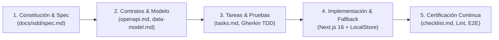

# Propuesta de Consultoría y Desarrollo Tecnológico
## Sistema Integral de Encuestas Dinámicas, Analítica Multidimensional y Despliegue Ciudadano

**Cliente:** Instituto Nacional de Transporte Terrestre (INTT)  
**Metodología:** Specification-Driven Development (SDD v1.2.0)  
**Fecha:** 29 de Septiembre de 2026  
**Documento:** `PROP-INTT-SDD-2026-01`  
**Estado:** Propuesta Técnica y Económica  

---

## 1. Resumen Ejecutivo

El Instituto Nacional de Transporte Terrestre (INTT) requiere una plataforma moderna, escalable, soberana y de alta disponibilidad para la recolección, auditoría y análisis estadístico en tiempo real de la opinión ciudadana sobre sus servicios de movilidad y trámites de transporte.

Con base en la especificación formal elaborada bajo la metodología **Specification-Driven Development (SDD v1.2.0)**, esta propuesta presenta el plan integral de consultoría y desarrollo tecnológico que garantiza:
- **Constructor visual dinámico** de encuestas con soporte para 8 tipos de preguntas estandarizadas y reglas de validación avanzadas.
- **Despliegue multicanal soberano** mediante URLs amigables, códigos cortos deterministas, códigos QR vectoriales y snippets embed institucionales.
- **Seguridad y mitigación de fraude** con evaluación de elegibilidad previa (pre-flight), protección anti-bots (Cloudflare Turnstile), anonimización criptográfica de IPs (SHA-256 + salt rotativo) y control de duplicidad.
- **Dashboards analíticos independientes por encuesta**, provistos de métricas en tiempo real, desglose visual por tipo de pregunta y exportación desacoplada en formato CSV (RFC 4180 con UTF-8 BOM).
- **Arquitectura de persistencia híbrida resiliente** (PostgreSQL 16 + Local Store) con disponibilidad ininterrumpida frente a incidencias de conectividad.

---

## 2. Metodología de Ejecución: Specification-Driven Development (SDD)

El desarrollo se fundamenta en un flujo estricto gobernado por especificación viva, lo que elimina desviaciones de alcance, mitiga retrabajos y garantiza trazabilidad absoluta:



- **Fases Iterativas (Sprints de 2 semanas):** Entregas funcionales desplegables al final de cada ciclo con pruebas automatizadas.
- **Cero Deuda Técnica:** Validación de tipado estricto, cobertura de pruebas unitarias/E2E y linting sin tolerancias (`0 errors, 0 warnings`).
- **Transferencia Tecnológica:** Entrega de código fuente documentado, pipelines CI/CD y capacitación a los equipos técnicos del INTT.

---

## 3. Plan de Trabajo y Desglose de Fases (WBS)

El proyecto se estructura en 8 fases de desarrollo basadas en el inventario formal de tareas [`tasks.md`](file:///c:/Users/IAEGEA/EncuestaINTTT/docs/sdd/tasks.md):

| Fase | Denominación y Alcance | Entregables Principales | Duración Estimada |
| :---: | :--- | :--- | :---: |
| **Fase 0** | **Fundaciones, Seguridad y RBAC** | Configuración base, esquema relacional PostgreSQL con Prisma ORM, autenticación unificada (JWT + HMAC-SHA256), roles RBAC (`admin`, `creator`, `analyst`). | 1.5 semanas |
| **Fase 1** | **Constructor Dinámico de Encuestas (Builder)** | CRUD de encuestas y preguntas, validación de 8 tipos de datos, diseñador interactivo drag-and-drop (`@dnd-kit`), previsualización dual móvil/escritorio. | 2.5 semanas |
| **Fase 2** | **Motor de Despliegue y Ciclo de Vida** | Máquina de estados (`draft`, `published`, `closed`, `archived`), generación de slug/QR SVG-PNG, control de vigencia temporal y cierre automático por cuota. | 1.5 semanas |
| **Fase 3** | **Validación de Encuestados y Seguridad** | Motor de elegibilidad pre-flight, 4 modos de acceso (anónimo, OTP email, token de invitación, whitelist), protección anti-bots (Turnstile) y consentimiento informado GDPR. | 2.0 semanas |
| **Fase 4** | **Ingesta Transaccional y Persistencia** | Endpoint transaccional de respuestas con validación 422 estricta, prevención criptográfica de duplicados y autoguardado de sesión en cliente. | 1.5 semanas |
| **Fase 5** | **Dashboard Multidimensional y Exportaciones** | Vistas analíticas independientes por encuesta (`SurveyAnalyticsView`), selector dinámico en cabecera, exportador RFC 4180 con UTF-8 BOM y reportes agregados. | 2.0 semanas |
| **Fase 6** | **Persistencia Híbrida y Alta Disponibilidad** | Capa `LocalSurveyStore` con fallback no bloqueante en caliente cuando PostgreSQL esté inaccesible, pruebas de estrés (k6) y hardening OWASP Top 10. | 1.5 semanas |
| **Fase 7** | **Pruebas E2E, Despliegue y Capacitación** | Suite Playwright integral, certificación bajo `checklist.md`, manuales operativos y talleres de transferencia técnica al personal del INTT. | 1.5 semanas |
| **Total** | **Ciclo de Vida Completo del Proyecto** | **Plataforma Integral Certificada en Producción** | **14 semanas (~3.5 meses)** |

---

## 4. Equipo de Consultoría y Perfiles Requeridos

Para asegurar los estándares de arquitectura enterprise, seguridad gubernamental y cumplimiento SDD, se dispone del siguiente equipo especializado:

1. **Lead Software Architect & SDD Specialist (Arquitecto Líder):**
   - Responsable del diseño de contratos OpenAPI, arquitectura de resiliencia híbrida, seguridad criptográfica y gobernanza del código.
2. **Senior Fullstack Engineer (Ingeniero Senior Frontend/Backend):**
   - Implementación de módulos en Next.js 16 (App Router, Turbopack, TailwindCSS), componentes del builder interactivo y analítica de datos.
3. **DevOps & Cloud Security Engineer:**
   - Configuración de entornos Docker/PostgreSQL, observabilidad, pipeline CI/CD, hardening de seguridad OWASP y optimización de base de datos.
4. **QA Automation & Performance Engineer:**
   - Diseño y ejecución de suites de prueba unitarias, de integración, E2E con Playwright y pruebas de estrés de alta concurrencia con k6.

---

## 5. Tabla de Costos y Presupuesto de Consultoría

> Los costos están calculados considerando tarifas estándar de consultoría tecnológica especializada en desarrollo de software gubernamental y arquitectura de alta concurrencia.

### 5.1. Desglose de Esfuerzo y Costos por Fase

| Fase | Descripción del Trabajo | Horas Estimadas | Tarifa Promedio / Hora | Subtotal (USD) |
| :---: | :--- | :---: | :---: | :---: |
| **Fase 0** | Fundaciones, Entorno, Autenticación Unificada y Esquema Prisma | 60 h | $45.00 | $2,700.00 |
| **Fase 1** | Constructor Dinámico (Builder), Tipos de Pregunta y Previsualización | 100 h | $45.00 | $4,500.00 |
| **Fase 2** | Motor de Despliegue, QR Vectorial, Vigencias y Código Corto | 60 h | $45.00 | $2,700.00 |
| **Fase 3** | Motor de Elegibilidad, Anti-Bots (Turnstile) y Modos de Acceso | 80 h | $50.00 | $4,000.00 |
| **Fase 4** | Ingesta Transaccional, Prevención de Fraude y Validación Server-Side | 60 h | $50.00 | $3,000.00 |
| **Fase 5** | Dashboard Analítico por Encuesta, Gráficas y Exportación CSV UTF-8 | 80 h | $45.00 | $3,600.00 |
| **Fase 6** | Motor de Resiliencia Híbrida (`LocalSurveyStore`) y Pruebas k6 | 60 h | $55.00 | $3,300.00 |
| **Fase 7** | Certificación Final E2E, Documentación SDD v1.2.0 y Capacitación | 60 h | $40.00 | $2,400.00 |
| **Total** | **Consultoría y Desarrollo Integral (Horas Directas)** | **560 h** | **—** | **$26,200.00** |

---

### 5.2. Servicios Complementarios de Acompañamiento y Soporte

| Concepto | Alcance y Entregables | Modalidad | Inversión (USD) |
| :--- | :--- | :---: | :---: |
| **Póliza de Soporte Técnico y Mantenimiento Evolutivo (Garantía Extendida)** | Monitoreo correctivo, parches de seguridad, optimizaciones de consultas y resolución de incidencias Nivel 3 (60 días post-lanzamiento). | Mensual (2 meses) | $2,400.00 ($1,200/mes) |
| **Taller de Transferencia Tecnológica y Certificación de Administradores** | 3 sesiones prácticas de 4 horas dirigidas a equipos de TI y analistas del INTT (manejo del builder, analítica, auditoría y despliegues). | Paquete único | $1,200.00 |
| **Infraestructura de Pruebas de Carga y Auditoría Externa** | Aprovisionamiento de nodos k6 para simulación de 1.000 usuarios concurrentes e informe de auditoría OWASP Top 10. | Hito único | $1,500.00 |
| **Total Servicios Complementarios** | — | — | **$5,100.00** |

---

### 5.3. Resumen Consolidado de la Inversión

| Componente de Inversión | Monto (USD) | % del Total |
| :--- | :---: | :---: |
| **1. Desarrollo e Implementación Técnica (Fases 0 a 7)** | $26,200.00 | 83.7% |
| **2. Soporte Post-Lanzamiento y Garantía (2 meses)** | $2,400.00 | 7.7% |
| **3. Transferencia Tecnológica y Capacitación** | $1,200.00 | 3.8% |
| **4. Infraestructura de Pruebas y Certificación de Seguridad** | $1,500.00 | 4.8% |
| **INVERSIÓN TOTAL DEL PROYECTO** | **$31,300.00** | **100.0%** |

---

## 6. Hitos y Esquema de Pagos Sugerido

Para garantizar la alineación con los entregables certificados bajo la metodología SDD, se propone el siguiente esquema de desembolsos por hitos cumplidos:

```mermaid
gantt
    title Cronograma de Hitos y Facturación
    dateFormat  YYYY-MM-DD
    section Pagos
    Anticipo Inicial (25%)          :milestone, m1, 2026-10-01, 0d
    Hito 1: Builder y Despliegue (25%) :milestone, m2, 2026-11-05, 0d
    Hito 2: Ingesta y Dashboard (25%) :milestone, m3, 2026-12-10, 0d
    Hito 3: Aceptación y Cierre (25%) :milestone, m4, 2027-01-15, 0d
```

1. **Hito 0 — Inicio de Proyecto (25% — $7,825.00):** A la firma del contrato y validación del entorno de trabajo base.
2. **Hito 1 — Constructor y Despliegue Multicanal (25% — $7,825.00):** Aprobación de Fases 0, 1 y 2 (Builder operativo, tipos de preguntas y generación de códigos QR).
3. **Hito 2 — Seguridad, Ingesta y Dashboard (25% — $7,825.00):** Aprobación de Fases 3, 4 y 5 (Motor de elegibilidad, submit transaccional y visualización analítica por encuesta).
4. **Hito 3 — Resiliencia, Certificación y Cierre (25% — $7,825.00):** Aprobación de Fases 6 y 7 (Pruebas E2E completas, certificación `checklist.md`, entrega de código fuente y talleres de capacitación).

---

## 7. Retorno de Inversión y Beneficios Institucionales

1. **Soberanía y Ahorro en Licenciamiento:** Eliminación permanente de suscripciones recurrentes a plataformas SaaS de terceros (como Typeform, SurveyMonkey o Qualtrics), con un ahorro anual estimado de más de $18,000 USD.
2. **Protección de Datos Institucionales:** Los datos de los ciudadanos y conductores se mantienen 100% bajo custodia interna en servidores soberanos del INTT.
3. **Toma de Decisiones Basada en Datos Reales:** Capacidad inmediata de consultar analítica segmentada por sedes, trámites, tipos de vehículo y temporalidad para orientar políticas públicas de movilidad.
4. **Cero Caídas Operativas:** Con la arquitectura de almacenamiento híbrido, las jornadas masivas de recolección en campo nunca se detendrán por fallos intermitentes de conectividad.

---

## 8. Términos y Condiciones Generales

- **Moneda de Cotización:** Dólares de los Estados Unidos de América (USD) o su equivalente en moneda nacional a la tasa oficial del BCV a la fecha de facturación.
- **Validez de la Oferta:** 30 días calendario a partir de la fecha de emisión.
- **Propiedad Intelectual:** La totalidad del código fuente, documentación de arquitectura (`docs/sdd/`), esquemas de base de datos y artefactos pertenecerán de manera exclusiva al Instituto Nacional de Transporte Terrestre (INTT).
